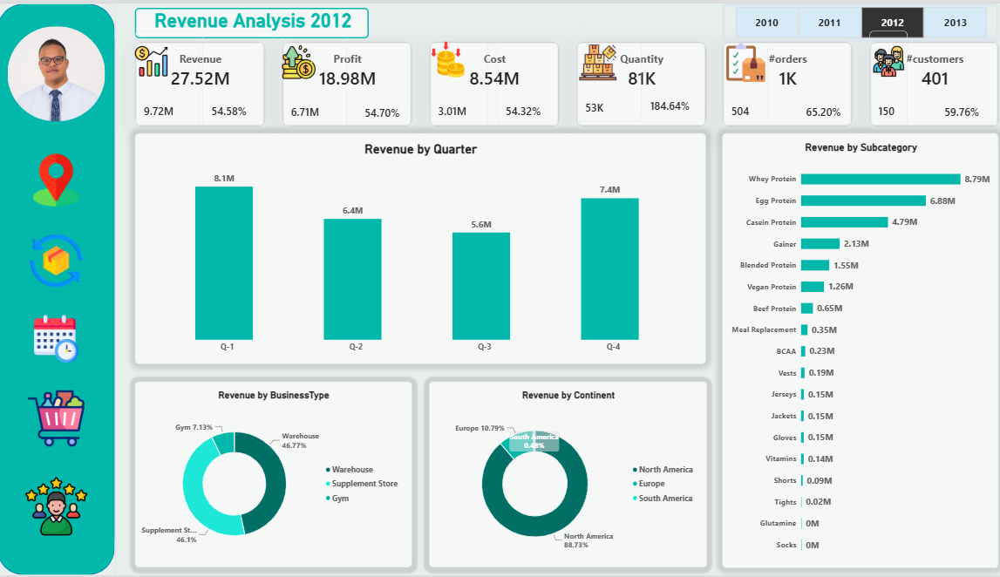
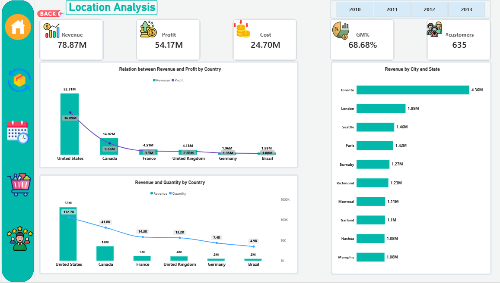
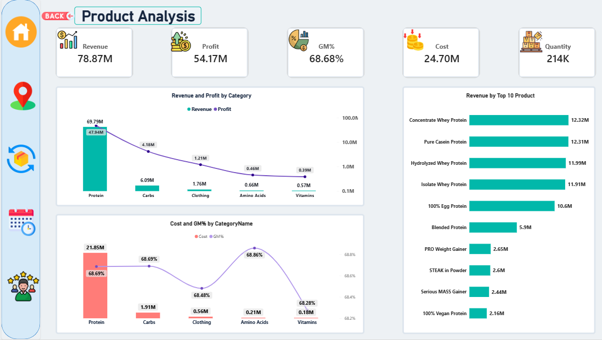
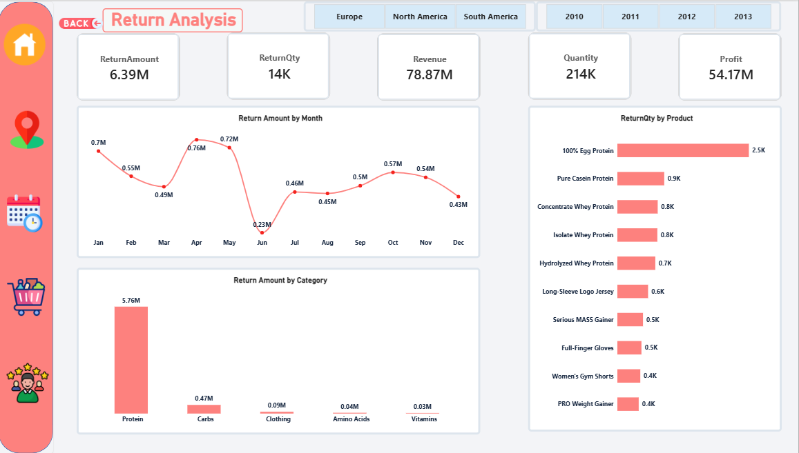
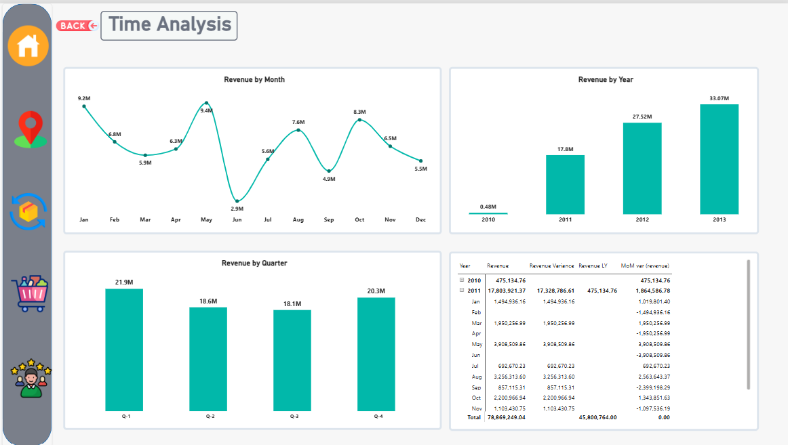
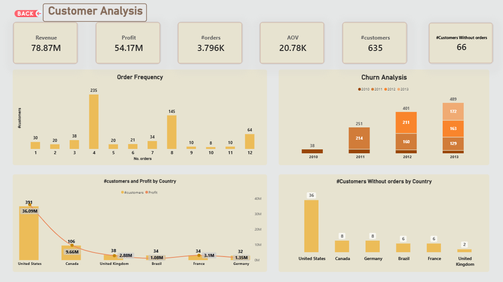

# Sales Performance Analysis Dashboard | Power BI

A six-page Power BI report exploring sales, profitability, products, locations, returns, time trends, and customer activity from 2010 to 2013. The report combines summary KPIs with interactive breakdowns by period, product, geography, and customer.

## Business questions

- How did revenue and profit change across the years, months, and quarters shown?
- Which product categories and products contribute the most revenue and profit?
- Which countries and cities have the highest reported sales and profit?
- How much value and quantity are returned, and how do returns vary by month, category, and product?
- How are orders distributed by customer, and how many customers have no orders in the report?
- How do revenue, cost, profit, and gross margin compare across the report's views?

## Key insights

- The report shows total revenue of **78.87M**, profit of **54.17M**, cost of **24.70M**, and gross margin of **68.68%**.
- Annual revenue rises across the years displayed: **0.48M (2010)**, **17.80M (2011)**, **27.52M (2012)**, and **33.07M (2013)**.
- Across all years, **Q1** has the highest displayed quarterly revenue (**21.9M**); Q2 is **18.6M**, Q3 is **18.1M**, and Q4 is **20.3M**.
- **Protein** is the largest product category by revenue (**69.79M**) and profit (**47.94M**) in the product view.
- The **United States** has the highest country revenue (**52.31M**) and profit (**36.09M**). **Toronto** is the leading city shown, with **4.36M** in revenue.
- The report shows **6.39M** in return amount and **14K** returned units. April has the highest displayed monthly return amount (**0.76M**); June has the lowest (**0.23M**).
- The customer page reports **635 customers**, including **66 customers without orders**, and **3.796K orders**. These are dashboard counts; the README does not infer why customers have no orders or define churn beyond the report's displayed analysis.

Values are transcribed from the supplied screenshots; chart labels are rounded. Annual revenue values are shown as displayed on the Time Analysis page.

## Dashboard pages

### Main page

2012 overview of revenue, profit, cost, quantity, orders, customers, quarterly revenue, product subcategories, business type, and continent.

### Location analysis

Revenue, profit, cost, gross margin, and customer counts by country, plus revenue by city.

### Product analysis

Revenue and profit by category, cost and gross margin by category, and revenue by the top 10 products.

### Return analysis

Return amount and quantity, monthly return trends, returns by category, and returned quantity by product.

### Time analysis

Revenue by month, year, and quarter, with a matrix showing revenue and time comparisons.

### Customer analysis

Order frequency, the displayed churn analysis, customer and profit by country, and customers without orders by country.

## Data and workflow

The project uses an Excel dataset prepared in Power Query and analyzed in Power BI. The report presents sales, product, customer, geography, return, and calendar views through connected report pages and measures.

## Tools

- Microsoft Power BI
- Power Query
- DAX
- Microsoft Excel

## Files

- `Sales-Performance-Analysis.pbix` — Power BI report.
- PNG files in the repository root — screenshots embedded above.

Open the `.pbix` file in Power BI Desktop to explore the report interactively.

